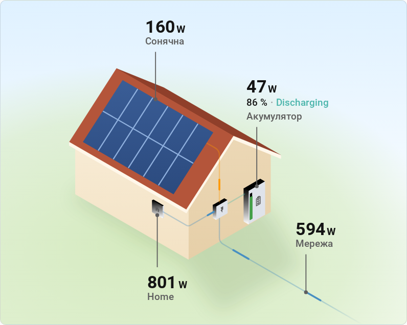

# Deye cards for Home Assistant

**🇬🇧 English** · [🇺🇦 Українська](README.uk.md)

Two dashboard cards for Home Assistant with a Deye inverter (Solarman / Sunsynk integrations, etc.):

1. **`deye-screen-card`** — a replica of the Deye inverter screen: housing with logo, DC / AC / Normal / Alarm LEDs, 4 gauges (solar, battery, grid, home) around the "ON" circle, animated flow arrows and a live clock.
2. **`home-flow-styled`** — a wrapper around [home-flow-card](https://github.com/rosenrot00/home-flow-card) that paints the grey house (walls, roof, panels, lawn, sky).

| deye-screen-card | home-flow-styled |
|---|---|
|  |  |

House colour variants:


---

## Installation

### Option 1 — manual

1. Copy the files to `/config/www/deye-cards/` (File editor, Samba or Studio Code Server):
   - `deye-screen-card.js`
   - `home-flow-styled.js` (only if you want the coloured house)
2. **Settings → Dashboards → ⋮ → Resources → Add resource**, type **JavaScript module**:
   - `/local/deye-cards/deye-screen-card.js`
   - `/local/deye-cards/home-flow-styled.js`
3. Reload the page with **Ctrl+F5**. In the HA mobile app: App settings → Troubleshooting → Reset frontend cache.

### Option 2 — HACS (deye-screen-card only)

HACS → ⋮ → **Custom repositories** → URL of this repository, type **Dashboard** → install.
In that case add `home-flow-styled.js` manually as in option 1.

### The house (home-flow-card)

`home-flow-styled` needs the house card itself:
HACS → Custom repositories → `https://github.com/rosenrot00/home-flow-card` (Dashboard) → install.

---

## deye-screen-card

```yaml
type: custom:deye-screen-card
solar: sensor.deye_pv_power
battery: sensor.deye_battery_power
battery_soc: sensor.deye_battery
grid: sensor.deye_grid_power
load: sensor.deye_load_power
grid_status: binary_sensor.deye_grid
alarm: sensor.deye_device_state
max: 8000
```

| Option | Required | Description |
|---|---|---|
| `solar` | yes | Solar panel power, W |
| `grid` | yes | Grid power, W. **Positive = import**, negative = export |
| `load` | yes | Home consumption, W |
| `battery` | no | Battery power, W. **Positive = discharge**, negative = charge (as in Deye/Solarman) |
| `battery_soc` | no | Battery state of charge, % — shown above the battery |
| `grid_status` | no | Grid presence `binary_sensor` → **AC** LED. Without it AC is lit whenever power flows through the grid |
| `alarm` | no | Alarm entity → red **Alarm** LED. Triggers on states `on`, `problem`, `Alarm`, `Fault` |
| `max` | no | Gauge limit in W, default `8000` |
| `frame` | no | `false` — screen only, without the housing |

The **DC** LED is lit when there is solar power or a battery is configured; **Normal** — when there is no alarm.

> If the battery or grid arrow points the wrong way, your integration uses the opposite sign. Create a template sensor multiplied by −1.

---

## home-flow-styled

```yaml
type: custom:home-flow-styled
background: linear-gradient(180deg,#dff1ff 0%,#f6fbff 60%,#eef7e6 100%)
vars:
  wall: "#f3e2c4"
  roof: "#b4553a"
  roof-back: "#8f3f2a"
  panel: "#2b4a7e"
  ground: "#d5eabf"
card:
  solar: {entity: sensor.deye_pv_power}
  battery: {entity: sensor.deye_battery_power, state_of_charge: sensor.deye_battery}
  grid: {entity: sensor.deye_grid_power}
  home: {entity: sensor.deye_load_power}
```

- `card:` — regular `home-flow-card` config (without `type`).
- `vars:` — house colours; each key becomes the CSS variable `--house-<key>`.
- `background:` — card background (colour or gradient).

Ready-made palettes are in [examples/palettes.md](examples/palettes.md), full examples in [examples/](examples/).

---

## Dashboard layout (sections)

Cards side by side on a PC, stacked on iPad / phone:

```yaml
type: grid
column_span: 4
cards:
  - type: heading
    heading: Energy flow
  - type: custom:home-flow-styled
    grid_options: {columns: 24}
    # ...
  - type: custom:deye-screen-card
    grid_options: {columns: 24}
    # ...
```

## License

MIT — see [LICENSE](LICENSE). `home-flow-card` belongs to its author and is not part of this repository.
