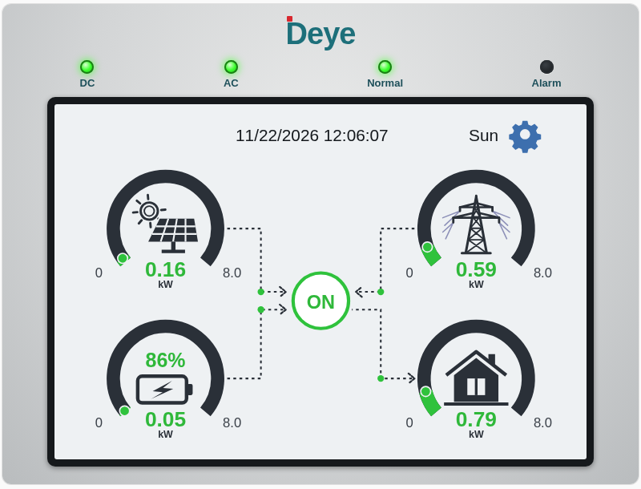

# Deye-картки для Home Assistant

Дві картки для дашборда Home Assistant з інвертором Deye (Solarman / Sunsynk тощо):

1. **`deye-screen-card`** — копія екрана інвертора Deye: корпус з логотипом, лампочки DC / AC / Normal / Alarm, 4 шкали (сонце, АКБ, мережа, дім) навколо «ON», анімовані стрілки потоку, годинник.
2. **`home-flow-styled`** — обгортка над [home-flow-card](https://github.com/rosenrot00/home-flow-card), яка розфарбовує сірий будиночок (стіни, дах, панелі, трава, небо).

| deye-screen-card | home-flow-styled |
|---|---|
|  |  |

Варіанти кольорів будиночка:


---

## Встановлення

### Спосіб 1 — вручну

1. Скопіюй файли в `/config/www/deye-cards/` (через File editor, Samba або Studio Code Server):
   - `deye-screen-card.js`
   - `home-flow-styled.js` (лише якщо потрібен кольоровий будиночок)
2. **Налаштування → Інформаційні панелі → ⋮ → Ресурси → Додати ресурс**, тип **JavaScript module**:
   - `/local/deye-cards/deye-screen-card.js`
   - `/local/deye-cards/home-flow-styled.js`
3. Онови сторінку з **Ctrl+F5**. На телефоні в застосунку HA: Налаштування застосунку → Налагодження → Очистити кеш фронтенду.

### Спосіб 2 — HACS (лише deye-screen-card)

HACS → ⋮ → **Custom repositories** → URL цього репозиторію, тип **Dashboard** → встановити.
`home-flow-styled.js` у такому разі додай вручну, як у способі 1.

### Будиночок (home-flow-card)

Для `home-flow-styled` потрібна сама картка будиночка:
HACS → Custom repositories → `https://github.com/rosenrot00/home-flow-card` (Dashboard) → встановити.

---

## deye-screen-card

```yaml
type: custom:deye-screen-card
solar: sensor.deye_pv_power
battery: sensor.deye_battery_power
battery_soc: sensor.deye_battery
grid: sensor.deye_grid_power
load: sensor.deye_load_power
grid_status: binary_sensor.deye_grid
alarm: sensor.deye_device_state
max: 8000
```

| Параметр | Обовʼязковий | Опис |
|---|---|---|
| `solar` | так | Потужність сонячних панелей, W |
| `grid` | так | Мережа, W. **Плюс — купівля**, мінус — продаж |
| `load` | так | Споживання будинку, W |
| `battery` | ні | АКБ, W. **Плюс — розряд**, мінус — заряд (як у Deye/Solarman) |
| `battery_soc` | ні | Заряд АКБ, % — показується над батареєю |
| `grid_status` | ні | `binary_sensor` наявності мережі → лампочка **AC**. Без нього AC горить, коли є потік через мережу |
| `alarm` | ні | Сутність аварії → червона лампочка **Alarm**. Спрацьовує на стани `on`, `problem`, `Alarm`, `Fault` |
| `max` | ні | Межа шкал у W, типово `8000` |
| `frame` | ні | `false` — лише екран без корпусу |

Лампочка **DC** горить, коли є сонце або налаштовано АКБ; **Normal** — коли немає аварії.

> Якщо стрілка АКБ або мережі показує протилежний напрямок — у твоїй інтеграції інший знак. Зроби шаблонний сенсор з множенням на −1.

---

## home-flow-styled

```yaml
type: custom:home-flow-styled
background: linear-gradient(180deg,#dff1ff 0%,#f6fbff 60%,#eef7e6 100%)
vars:
  wall: "#f3e2c4"
  roof: "#b4553a"
  roof-back: "#8f3f2a"
  panel: "#2b4a7e"
  ground: "#d5eabf"
card:
  solar: {entity: sensor.deye_pv_power}
  battery: {entity: sensor.deye_battery_power, state_of_charge: sensor.deye_battery}
  grid: {entity: sensor.deye_grid_power}
  home: {entity: sensor.deye_load_power}
```

- `card:` — звичайний конфіг `home-flow-card` (без `type`).
- `vars:` — кольори будиночка; кожен ключ стає CSS-змінною `--house-<ключ>`.
- `background:` — фон картки (колір або градієнт).

Готові палітри — у [examples/palettes.md](examples/palettes.md), повні приклади — у [examples/](examples/).

---

## Розкладка на дашборді (sections)

Щоб на ПК картки стояли поруч, а на iPad / телефоні — одна під одною:

```yaml
type: grid
column_span: 4
cards:
  - type: heading
    heading: Потік енергії
  - type: custom:home-flow-styled
    grid_options: {columns: 24}
    # ...
  - type: custom:deye-screen-card
    grid_options: {columns: 24}
    # ...
```

## Ліцензія

MIT — див. [LICENSE](LICENSE). `home-flow-card` належить своєму автору й у цей репозиторій не входить.
