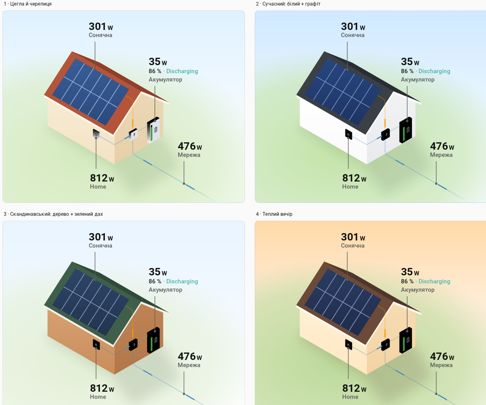

# Deye cards for Home Assistant

**🇬🇧 English** · [🇺🇦 Українська](README.uk.md)

Two dashboard cards for Home Assistant with a Deye inverter (Solarman / Sunsynk integrations, etc.):

1. **`deye-screen-card`** — a replica of the Deye inverter screen: housing with logo, DC / AC / Normal / Alarm LEDs, 4 gauges (solar, battery, grid, home) around the "ON" circle, animated flow arrows and a live clock.
2. **`home-flow-styled`** — a wrapper around [home-flow-card](https://github.com/flixlix/home-flow-card) that paints the grey house (walls, roof, panels, lawn, sky).

| deye-screen-card | home-flow-styled |
|---|---|
|  |  |

House colour variants:



---

## Installation

Both cards ship **in a single file** `ha-deye-cards.js`. Install once, then pick the one you want in "Add card":
- **Deye inverter screen**;
- **Coloured house**.

### ⚡ Quick — one-click buttons (Home Assistant 2026+)

Click a button → your Home Assistant opens straight on the right Marketplace page → **Install**.
(The first time my.home-assistant.io asks for your HA address, e.g. `http://192.168.1.10:8123`.)

| What | Button |
|---|---|
| **1. These cards** (Deye screen + coloured house) | [](https://my.home-assistant.io/redirect/hacs_repository/?owner=Taras1112&repository=ha-deye-cards&category=plugin) |
| **2. Home Flow Card by flixlix** (needed for the coloured house) | [](https://my.home-assistant.io/redirect/hacs_repository/?owner=flixlix&repository=home-flow-card&category=plugin) |

Then reload with **Ctrl+F5**.

### Option 1 — Marketplace manually

HACS is now built into Home Assistant as **Marketplace** (sidebar → Marketplace, or `/marketplace`).

1. Marketplace → ⋮ → **Add from GitHub link** → `https://github.com/Taras1112/ha-deye-cards` → Add → **Install**.
2. For the house, also install **Home Flow Card** by **flixlix** (*"Your own little isometric home…"*) — easiest via [this link](https://my.home-assistant.io/redirect/hacs_repository/?owner=flixlix&repository=home-flow-card&category=plugin), search shows many similar cards.
   > ⚠️ There is another card with the same name by `rosenrot00` (a flow editor) — that is **not** the house.
3. Reload the page (**Ctrl+F5**).

Older HA with HACS: HACS → ⋮ → Custom repositories → same URL, type **Dashboard**.

### Option 2 — manual

1. Copy to `/config/www/deye-cards/` either the single `ha-deye-cards.js` (both cards) or only the one you need:
   - `deye-screen-card.js` — Deye screen only;
   - `home-flow-styled.js` — house only (also needs flixlix/home-flow-card).
2. **Settings → Dashboards → ⋮ → Resources → Add resource**, type **JavaScript module**, e.g. `/local/deye-cards/ha-deye-cards.js`.
3. Reload with **Ctrl+F5**. In the HA mobile app: App settings → Troubleshooting → Reset frontend cache.

### Adding a card

Dashboard → ✏️ Edit → **Add card** → search for **Deye** or **house** → pick it.
The card finds your inverter sensors automatically (`sensor.<name>_pv_power`, `_battery_power`, `_battery`, `_grid_power`, `_load_power`) — if yours are named differently, fix them in the card's YAML editor.

---

## deye-screen-card

```yaml
type: custom:deye-screen-card
solar: sensor.deye_pv_power
battery: sensor.deye_battery_power
battery_soc: sensor.deye_battery
grid: sensor.deye_grid_power
load: sensor.deye_load_power
grid_status: binary_sensor.deye_grid
alarm: sensor.deye_device_state
max: 8000
```

| Option | Required | Description |
|---|---|---|
| `solar` | yes | Solar panel power, W |
| `grid` | yes | Grid power, W. **Positive = import**, negative = export |
| `load` | yes | Home consumption, W |
| `battery` | no | Battery power, W. **Positive = discharge**, negative = charge (as in Deye/Solarman) |
| `battery_soc` | no | Battery state of charge, % — shown above the battery |
| `grid_status` | no | Grid presence `binary_sensor` → **AC** LED. Without it AC is lit whenever power flows through the grid |
| `alarm` | no | Alarm entity → red **Alarm** LED. Triggers on states `on`, `problem`, `Alarm`, `Fault` |
| `max` | no | Gauge limit in W, default `8000` |
| `frame` | no | `false` — screen only, without the housing |

The **DC** LED is lit when there is solar power or a battery is configured; **Normal** — when there is no alarm.

> If the battery or grid arrow points the wrong way, your integration uses the opposite sign. Create a template sensor multiplied by −1.

---

## home-flow-styled

```yaml
type: custom:home-flow-styled
background: linear-gradient(180deg,#dff1ff 0%,#f6fbff 60%,#eef7e6 100%)
vars:
  wall: "#f3e2c4"
  roof: "#b4553a"
  roof-back: "#8f3f2a"
  panel: "#2b4a7e"
  ground: "#d5eabf"
card:
  solar: {entity: sensor.deye_pv_power}
  battery: {entity: sensor.deye_battery_power, state_of_charge: sensor.deye_battery}
  grid: {entity: sensor.deye_grid_power}
  home: {entity: sensor.deye_load_power}
```

- `card:` — regular `home-flow-card` config (without `type`).
- `vars:` — house colours; each key becomes the CSS variable `--house-<key>`.
- `background:` — card background (colour or gradient).

Ready-made palettes are in [examples/palettes.md](examples/palettes.md), full examples in [examples/](examples/).

---

## Dashboard layout (sections)

Side by side on screens ≥ 1024 px, stacked on iPad / phone:

```yaml
type: grid
column_span: 4
cards:
  - type: heading
    heading: Energy flow
  - type: horizontal-stack          # PC: side by side
    grid_options: {columns: full}
    visibility: [{condition: screen, media_query: "(min-width: 1024px)"}]
    cards:
      - type: custom:home-flow-styled   # …
      - type: custom:deye-screen-card   # …
  - type: vertical-stack            # iPad / phone: stacked
    grid_options: {columns: full}
    visibility: [{condition: screen, media_query: "(max-width: 1023px)"}]
    cards:
      - type: custom:home-flow-styled   # …
      - type: custom:deye-screen-card   # …
```

## License

MIT — see [LICENSE](LICENSE). `home-flow-card` belongs to its author and is not part of this repository.
