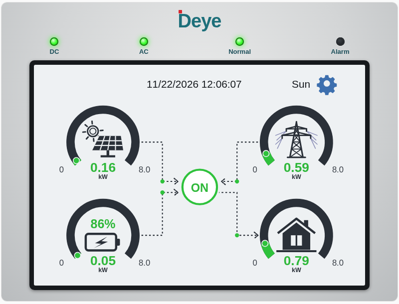
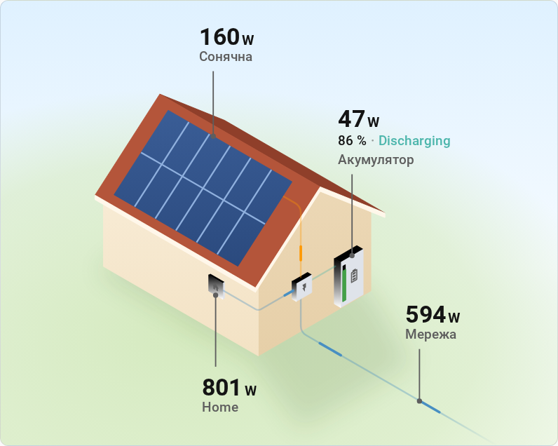
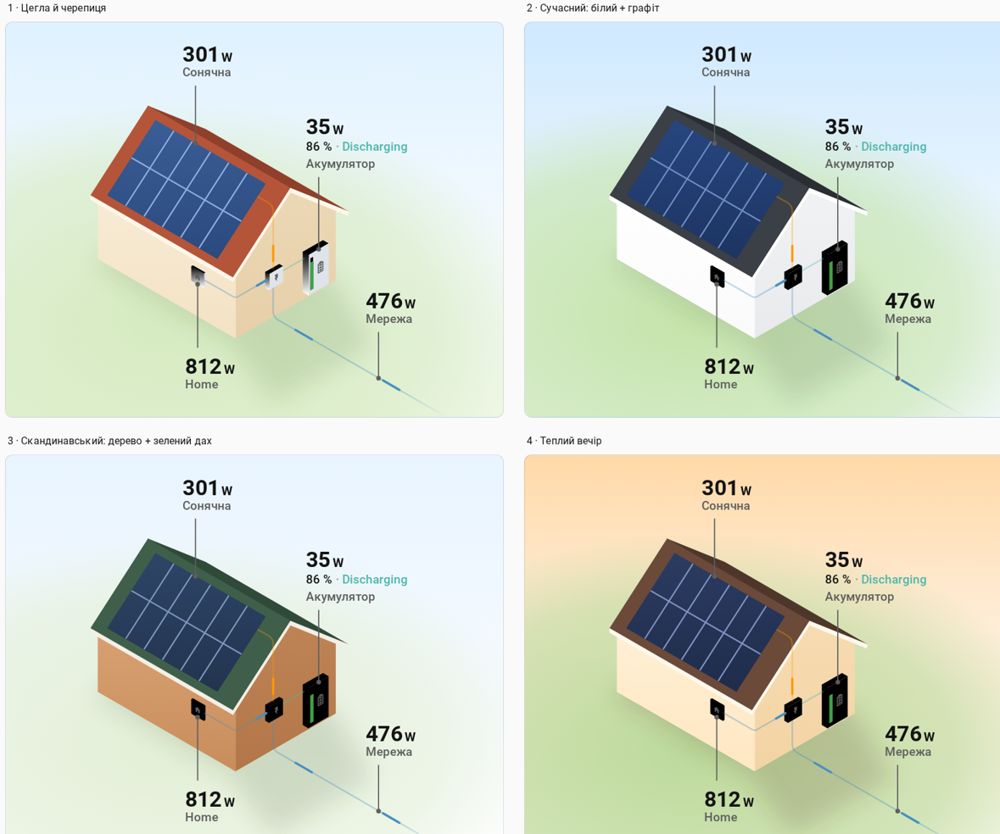

# Deye-картки для Home Assistant

**🇺🇦 Українська** · [🇬🇧 English](README.md)

Дві картки для дашборда Home Assistant з інвертором Deye (Solarman / Sunsynk тощо):

1. **`deye-screen-card`** — копія екрана інвертора Deye: корпус з логотипом, лампочки DC / AC / Normal / Alarm, 4 шкали (сонце, АКБ, мережа, дім) навколо «ON», анімовані стрілки потоку, годинник.
2. **`home-flow-styled`** — обгортка над [home-flow-card](https://github.com/flixlix/home-flow-card), яка розфарбовує сірий будиночок (стіни, дах, панелі, трава, небо).

| deye-screen-card | home-flow-styled |
|---|---|
|  |  |

Варіанти кольорів будиночка:



---

## Встановлення

Обидві картки лежать **в одному файлі** `ha-deye-cards.js`. Ставиш один раз, а далі у «Додати картку» вибираєш потрібну:
- **Deye — екран інвертора**;
- **Будиночок кольоровий**.

### Спосіб 1 — Магазин (Home Assistant 2026+)

HACS тепер вбудований у Home Assistant як **Магазин** (Marketplace: бокове меню → Marketplace, або адреса `/marketplace`).

1. Магазин → ⋮ → **Додати з посилання GitHub** → `https://github.com/Taras1112/ha-deye-cards` → Додати → **Встановити**.
2. Для будиночка ще встанови з Магазину картку **Home Flow Card** від **flixlix** (*«Your own little isometric home…»*).
   > ⚠️ Є ще картка з такою самою назвою від `rosenrot00` (редактор потоків) — це **не** будиночок.
3. Онови сторінку (**Ctrl+F5**).

Старіша HA з HACS: HACS → ⋮ → Custom repositories → те саме посилання, тип **Dashboard**.

### Спосіб 2 — вручну

1. Скопіюй у `/config/www/deye-cards/` або один файл `ha-deye-cards.js` (обидві картки), або лише потрібний:
   - `deye-screen-card.js` — тільки екран Deye;
   - `home-flow-styled.js` — тільки будиночок (потрібна ще flixlix/home-flow-card).
2. **Налаштування → Інформаційні панелі → ⋮ → Ресурси → Додати ресурс**, тип **JavaScript module**, напр. `/local/deye-cards/ha-deye-cards.js`.
3. Онови сторінку з **Ctrl+F5**. У застосунку HA на телефоні: Налаштування застосунку → Налагодження → Очистити кеш фронтенду.

### Як додати картку

Дашборд → ✏️ Редагувати → **Додати картку** → у пошуку набери **Deye** або **Будиночок** → обери.
Картка сама знайде сенсори інвертора (`sensor.<назва>_pv_power`, `_battery_power`, `_battery`, `_grid_power`, `_load_power`) — якщо назви інші, поправ у YAML-редакторі картки.

---

## deye-screen-card

```yaml
type: custom:deye-screen-card
solar: sensor.deye_pv_power
battery: sensor.deye_battery_power
battery_soc: sensor.deye_battery
grid: sensor.deye_grid_power
load: sensor.deye_load_power
grid_status: binary_sensor.deye_grid
alarm: sensor.deye_device_state
max: 8000
```

| Параметр | Обовʼязковий | Опис |
|---|---|---|
| `solar` | так | Потужність сонячних панелей, W |
| `grid` | так | Мережа, W. **Плюс — купівля**, мінус — продаж |
| `load` | так | Споживання будинку, W |
| `battery` | ні | АКБ, W. **Плюс — розряд**, мінус — заряд (як у Deye/Solarman) |
| `battery_soc` | ні | Заряд АКБ, % — показується над батареєю |
| `grid_status` | ні | `binary_sensor` наявності мережі → лампочка **AC**. Без нього AC горить, коли є потік через мережу |
| `alarm` | ні | Сутність аварії → червона лампочка **Alarm**. Спрацьовує на стани `on`, `problem`, `Alarm`, `Fault` |
| `max` | ні | Межа шкал у W, типово `8000` |
| `frame` | ні | `false` — лише екран без корпусу |

Лампочка **DC** горить, коли є сонце або налаштовано АКБ; **Normal** — коли немає аварії.

> Якщо стрілка АКБ або мережі показує протилежний напрямок — у твоїй інтеграції інший знак. Зроби шаблонний сенсор з множенням на −1.

---

## home-flow-styled

```yaml
type: custom:home-flow-styled
background: linear-gradient(180deg,#dff1ff 0%,#f6fbff 60%,#eef7e6 100%)
vars:
  wall: "#f3e2c4"
  roof: "#b4553a"
  roof-back: "#8f3f2a"
  panel: "#2b4a7e"
  ground: "#d5eabf"
card:
  solar: {entity: sensor.deye_pv_power}
  battery: {entity: sensor.deye_battery_power, state_of_charge: sensor.deye_battery}
  grid: {entity: sensor.deye_grid_power}
  home: {entity: sensor.deye_load_power}
```

- `card:` — звичайний конфіг `home-flow-card` (без `type`).
- `vars:` — кольори будиночка; кожен ключ стає CSS-змінною `--house-<ключ>`.
- `background:` — фон картки (колір або градієнт).

Готові палітри — у [examples/palettes.md](examples/palettes.md), повні приклади — у [examples/](examples/).

---

## Розкладка на дашборді (sections)

Від 1024 px — поруч, на iPad / телефоні — одна під одною:

```yaml
type: grid
column_span: 4
cards:
  - type: heading
    heading: Потік енергії
  - type: horizontal-stack          # ПК: поруч
    grid_options: {columns: full}
    visibility: [{condition: screen, media_query: "(min-width: 1024px)"}]
    cards:
      - type: custom:home-flow-styled   # …
      - type: custom:deye-screen-card   # …
  - type: vertical-stack            # iPad / телефон: одна під одною
    grid_options: {columns: full}
    visibility: [{condition: screen, media_query: "(max-width: 1023px)"}]
    cards:
      - type: custom:home-flow-styled   # …
      - type: custom:deye-screen-card   # …
```

## Ліцензія

MIT — див. [LICENSE](LICENSE). `home-flow-card` належить своєму автору й у цей репозиторій не входить.
